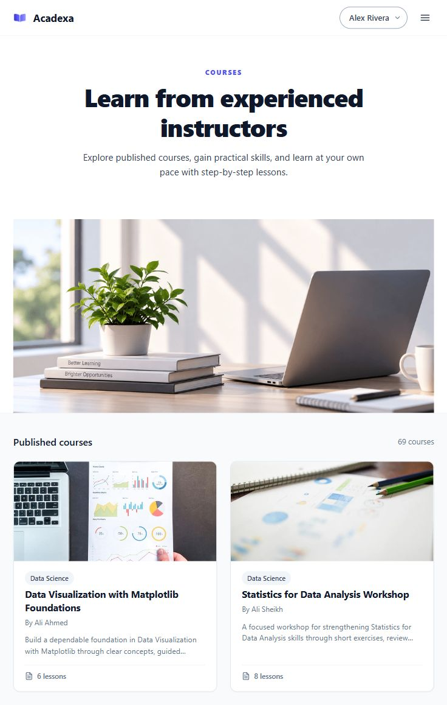
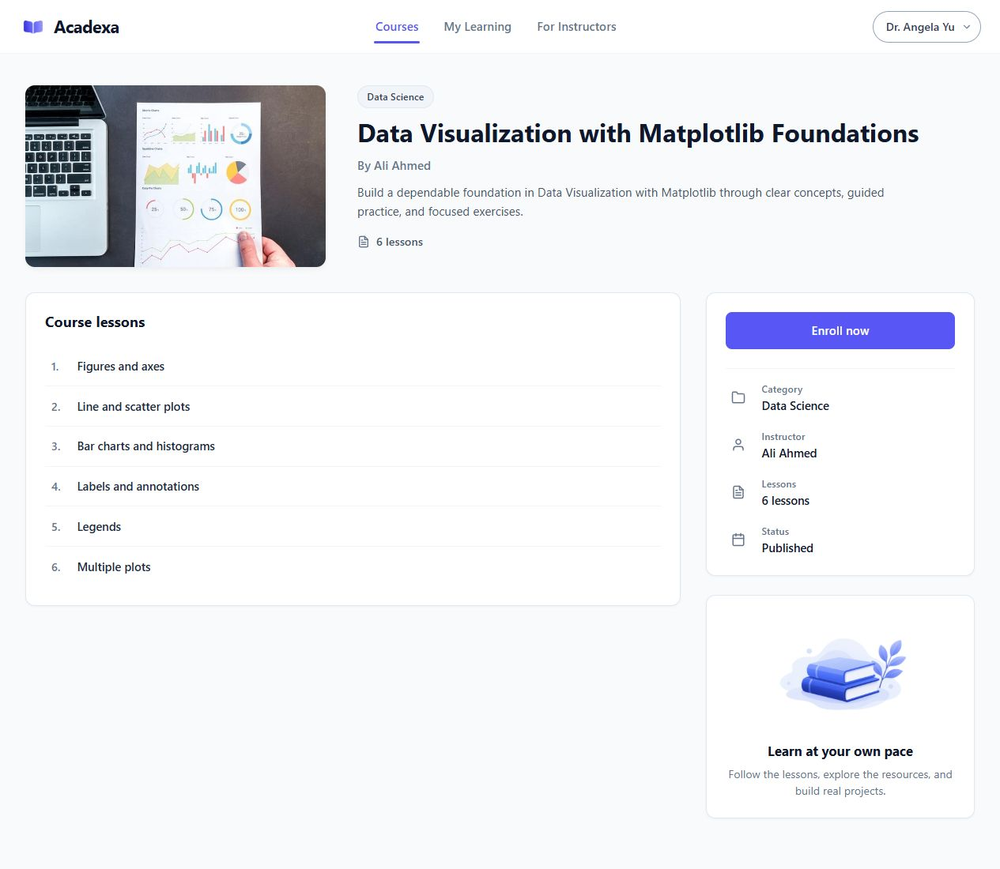
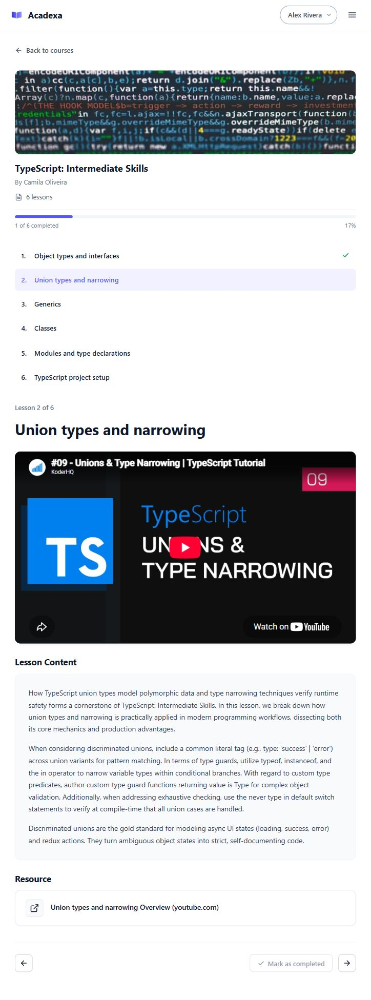
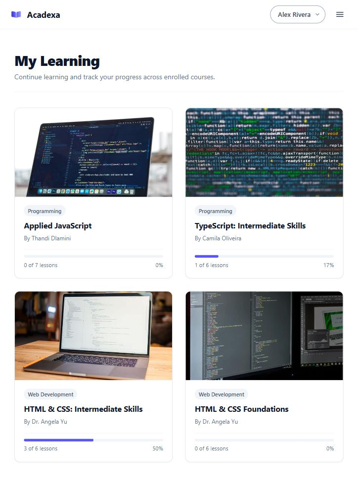
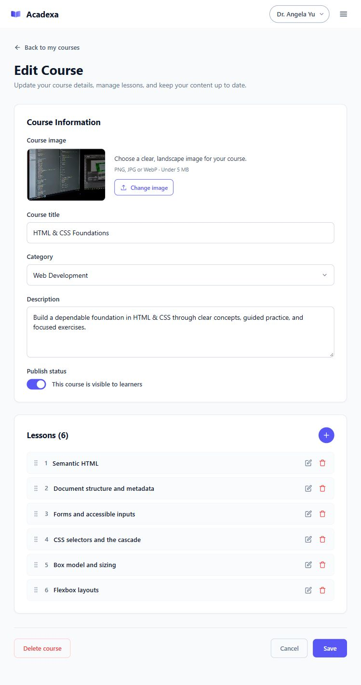
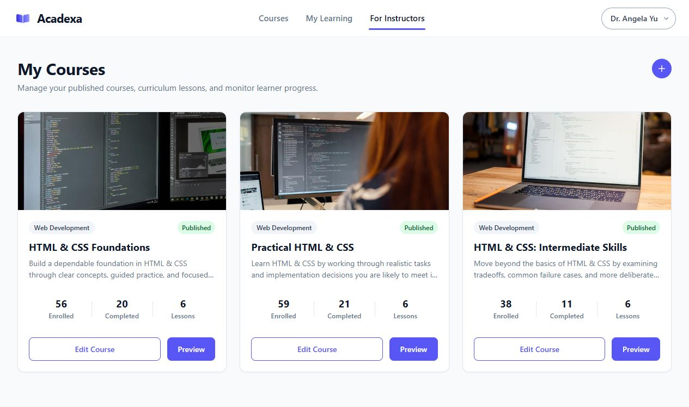

# Acadexa

Acadexa brings practical courses, focused lessons, and learning progress into one place. Learners can discover a course, work through its lessons, and return to their next step. Instructors can turn their knowledge into a structured curriculum and manage it as their courses grow.

## For learners

### Find your next course

Explore published courses and review their descriptions, instructors, and lesson outlines before enrolling. Choose a topic that fits what you want to learn next.

### Focus on one lesson at a time

Read lesson content, watch supported videos, and open additional resources in a dedicated classroom. Move between lessons using the curriculum or the previous and next controls.

### See your progress

Mark lessons as completed and follow your course progress. **My Learning** keeps enrolled courses together, shows completed lesson counts, and helps you continue from your next unfinished lesson.

## For instructors

### Build a course around your expertise

Give your course a title, category, description, and cover image. Add lessons with written content and supporting resources to create a clear learning path.

### Publish when you are ready

Keep a course as a draft while preparing it, then publish it for learners to discover. Preview your course and update its details and lessons from your course editor.

### Manage your courses in one place

**My Courses** brings together your curriculum, publication status, enrollment counts, and completion counts. Edit your courses and see how many learners have enrolled or finished.

## Learning that fits your day

Acadexa adapts its navigation and course layouts for desktop, tablet, and mobile screens. Your account supports both learning and teaching, so you can build your own skills while sharing them with others.

## License

This project is licensed under the [MIT](LICENSE) License.
